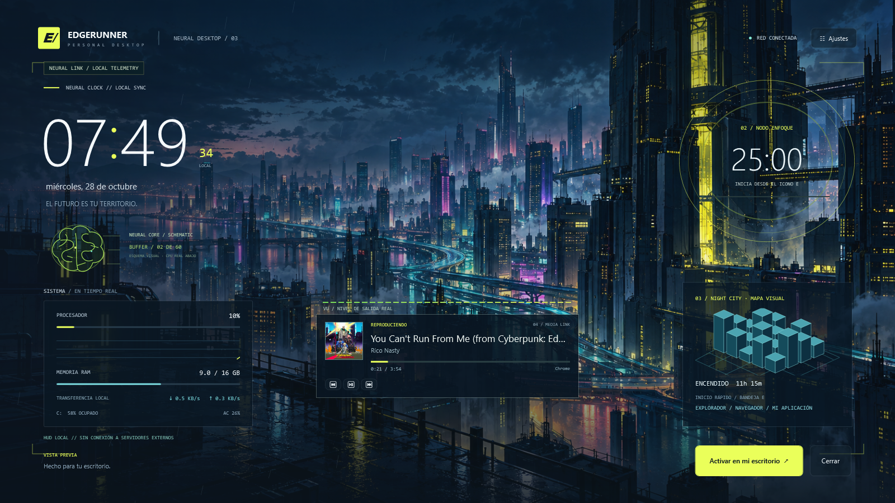

# Cyberpunk · EDGERUNNER Nightfall

### Versión 0.3 · Media Link

Diseño inspirado en un HUD cyberpunk: enfoque circular, esquema neural decorativo, mapa isométrico visual y panel multimedia central, sin título grande en medio.

El panel lee la sesión multimedia compartida con Windows: título, artista, carátula cuando esté disponible, estado y progreso. Funciona con las aplicaciones y páginas que integran los controles multimedia del sistema; no puede obtener metadatos de cualquier sonido o página que no los publique. El menú E permite anterior, reproducir/pausar y siguiente, cuando la sesión lo admite. En la vista previa también hay botones.

Las barras responden al pico real de salida del dispositivo de audio predeterminado. Su silueta es decorativa: representan amplitud, no un análisis de frecuencias FFT. No se graba ni se almacena audio. Un reproductor puede publicar metadatos mientras está pausado; en ese caso se conserva la canción y aparece «En pausa».

En Personalizar puedes ocultar la música y el medidor. Los datos multimedia se consultan localmente mediante Windows Media Control, sin iniciar sesión ni instalar extensiones. El mapa y el esquema neural son gráficos decorativos; no representan ubicación real, temperatura, seguridad ni actividad cerebral.

La compilación usa además `source/Media.cs`, los metadatos WinRT de Windows en `System32/WinMetadata` y la referencia System.Runtime de .NET Framework. Todos estaban presentes en el equipo de desarrollo; no se agregaron paquetes externos al ejecutable.

Referencia de la integración: [Windows Media Control](https://learn.microsoft.com/en-us/uwp/api/windows.media.control.globalsystemmediatransportcontrolssessionmanager).

### Versión 0.2 · Neural Desktop

Interfaz HUD con marcos angulares, paneles numerados y acentos neón. Añade historial real de CPU (hasta 60 muestras), transferencia de red, tiempo desde el arranque, sesiones de enfoque de 25 minutos y un acceso rápido configurable.

**Controles nuevos:** en el icono E puedes iniciar, pausar o reiniciar el enfoque. En **Personalizar → Elegir acceso rápido** seleccionas una aplicación o archivo existente; después lo abres desde el menú E. Los paneles del fondo muestran información; las acciones se controlan desde la bandeja.

El enfoque avisa al terminar mientras la aplicación está abierta. No bloquea programas y se reinicia si cierras la aplicación. El tiempo desde el arranque incluye suspensión y puede conservarse entre apagados si Windows usa Inicio rápido. La tasa de red mide la suma de bytes de interfaces activas (puede incluir adaptadores virtuales), no la velocidad contratada de Internet. La gráfica se llena con muestras reales a medida que la aplicación funciona.

Una aplicación portable que convierte el escritorio de Windows 11 en una ciudad cyberpunk con lluvia animada, reloj y paneles con datos reales del equipo.



## Características

- Fondo panorámico integrado y lluvia animada.
- Reloj con segundos y fecha local.
- CPU global, RAM usada y total, disco del sistema, batería y estado de red.
- Tres colores de interfaz: Edgerunners, Netrunner y Arasaka.
- Controles para ocultar el reloj y los datos, detener la lluvia y pausar la animación al usar batería.
- Pausa de la lluvia cuando una aplicación ocupa toda la pantalla principal.
- Inicio automático opcional al entrar a la sesión de Windows.
- Menú en la bandeja del sistema con ajustes y accesos al Explorador, navegador y configuración.

## Cómo usarlo

1. Descarga este repositorio desde **Code → Download ZIP** y descomprímelo.
2. Abre **`portable/EDGERUNNER.exe`**.
3. Revisa la vista previa y pulsa **Activar en mi escritorio**.
4. Para personalizarlo, haz doble clic en el icono **E** de la bandeja, junto al reloj de Windows. Puede estar dentro de los iconos ocultos.
5. Si quieres que aparezca al encender la laptop, activa **Iniciar con Windows** en los ajustes.

Conserva el ejecutable en la misma ubicación si activas el inicio automático. Si lo mueves, desactiva y vuelve a activar esa opción desde su nueva ubicación.

Para cerrar la aplicación, usa **Salir y restaurar escritorio** en el menú del icono E. El fondo anterior vuelve a verse. Para impedir futuros inicios, desmarca también **Iniciar con Windows**.

### Requisitos

- Windows 11 de 64 bits.
- .NET Framework 4.8 y WPF, componentes presentes en el equipo donde se desarrolló y probó.

No requiere Rainmeter, Lively Wallpaper, Node.js, Python ni un servidor. El ejecutable contiene la imagen, el icono y el diseño. No necesita permisos de administrador.

## Tecnologías y funcionamiento

| Componente | Función |
| --- | --- |
| C# | Lógica de la aplicación, ajustes y métricas |
| WPF / XAML | Composición de la interfaz y vista previa |
| Windows Forms / GDI | Superficie de dibujo del escritorio y bandeja del sistema |
| Win32 | Integración con Explorer y lectura de CPU y memoria |
| XML | Preferencias locales |

WPF compone la interfaz. Para mostrarla en el escritorio, una superficie nativa GDI se integra con las ventanas de Explorer, debajo de los iconos. La lluvia se dibuja por separado del contenido que se actualiza cada segundo.

La integración contempla la estructura de capas de Windows 11 24H2 y posteriores. La primera implementación podía crear una ventana que existía, pero quedaba oculta; la versión incluida conecta explícitamente la superficie al escritorio después de que Windows Forms termina de abrirla.

## Estructura

```text
Cyberpunk/
├── portable/
│   └── EDGERUNNER.exe      # Aplicación lista para ejecutar
├── source/
│   ├── Edgerunner.cs       # Aplicación e integración nativa
│   ├── Interface.xaml     # Diseño de la interfaz
│   ├── night-city.png     # Fondo integrado
│   ├── edgerunner.ico     # Icono de la aplicación
│   ├── app.manifest       # Compatibilidad, DPI y permisos
│   └── Build.ps1          # Compilación local
└── docs/
    └── vista-previa.png
```

## Compilar

Desde la carpeta del repositorio, ejecuta en PowerShell:

```powershell
& .\source\Build.ps1
```

El script usa el compilador de .NET Framework de Windows y genera **`EDGERUNNER.exe`** en la raíz. No modifica la copia de `portable/` automáticamente.

Para comprobar el renderizado, las métricas y el guardado de preferencias:

```powershell
Start-Process -FilePath .\EDGERUNNER.exe -ArgumentList '--self-test' -Wait
```

La prueba escribe una imagen y un informe en `%LOCALAPPDATA%\EdgerunnerOS`. Ese render permite revisar la interfaz, pero la visibilidad final debe comprobarse en el escritorio de Windows.

## Datos y configuración

Las preferencias y el registro de errores se guardan localmente en `%LOCALAPPDATA%\EdgerunnerOS`. El inicio automático opcional crea una entrada de inicio para el usuario actual. La aplicación no transmite las métricas a un servidor.

**Red conectada** indica que Windows detecta una interfaz de red disponible; no es una prueba de acceso a Internet. El fondo es una ilustración con lluvia superpuesta, no una escena 3D ni un vídeo.

## Estado y límites

Probado en una laptop con Windows 11, monitor de 1920 × 1080 y escala del 125%. Se comprobaron el ejecutable aislado, las métricas, los ajustes, el cierre y la visibilidad real del fondo tras corregir la integración con Explorer.

- Se aplica al monitor principal.
- Conserva los iconos y la barra de tareas de Windows.
- El inicio automático ocurre después de iniciar sesión; no cambia la pantalla de bloqueo.
- Una actualización de Explorer puede requerir ajustes en la integración nativa.
- El ejecutable no tiene firma comercial.

Proyecto personal inspirado en la estética cyberpunk, sin afiliación oficial con Cyberpunk 2077 o Cyberpunk: Edgerunners.
